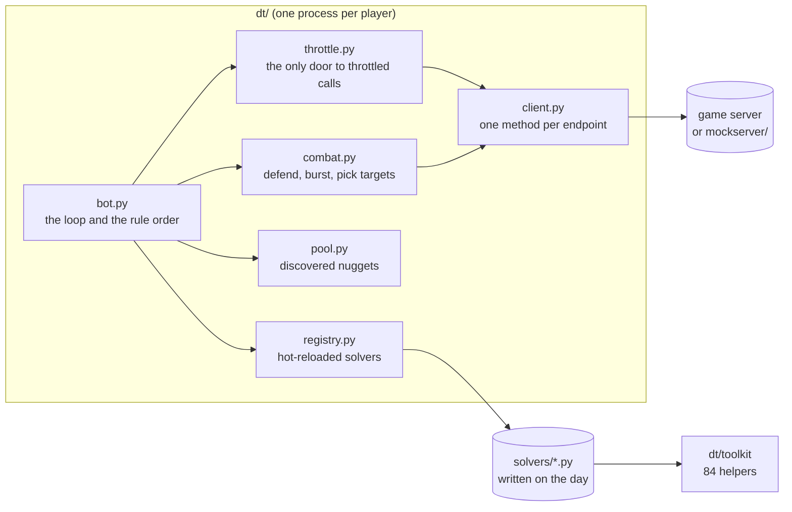
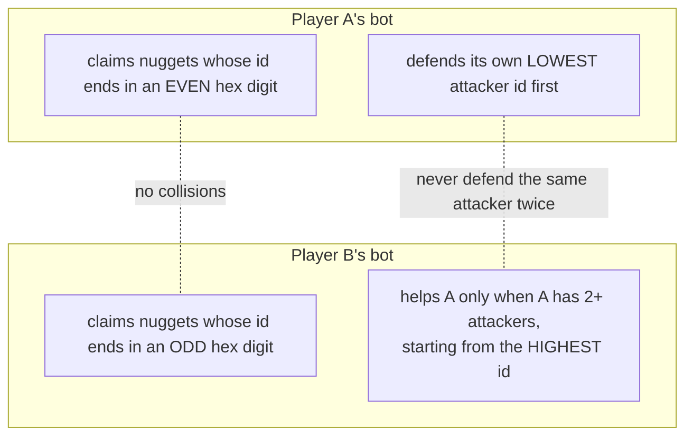

<div align="center">

# Double Trouble bot

**An autonomous two-player bot for the *Double Trouble Reloaded* team hackathon,
with a full offline replica of the game to practise against.**

[](https://github.com/Aymenrahmanii/Hackathon_ATS_BOT/actions/workflows/tests.yml)


[](LICENSE)

</div>

In the hackathon, every player gets **one API action every 3 seconds** to answer puzzle
questions ("nuggets") worth 1, 2 or 3 points. Calling too early costs a point. Rivals can
slow you down by attacking, and teammates can defend each other. New question types are
revealed at the start of each of three rounds, and on the day there is **no internet and
no AI**: you write the solvers by hand while your bot keeps playing.

This repository is the bot, the toolkit for writing solvers fast, and a mock server that
replays the whole game, including timed rounds, rival teams and unseen practice questions.

<p align="center">
  
  <br><sub>A real run against the mock at the real 3-second throttle (example questions trimmed).
  Midway a teammate saves a new solver, rivals attack, and the round changes.</sub>
</p>

> [!NOTE]
> Unofficial and not affiliated with the organisers. Built for the team session of
> November 25, 2026, from the public rules (spec v1.6).

## How it works

Each bot runs one loop forever. It sleeps until its throttle runs out, re-reads the game
state from the free endpoints, then spends the slot on the first rule that applies.

<p align="center">
  
</p>

The refresh step is what makes the bot safe: an attack that lands during the wait raises
the throttle, and a bot that fires on the old value pays a penalty. This one never has,
across every test and live run so far.



### Two players, one score

Both teammates run the same code on their own laptops. They never need to talk to each
other's bot:



## Features

- **Never calls early.** Every throttled call goes through one gate that re-reads the
  throttle just before firing and backs off on `429`, `503`, timeouts and expired tokens.
- **Solvers hot-reload.** Save `solvers/<type>.py` and the running bot picks it up. A new
  solver is on probation: one wrong answer pauses it and logs the question.
- **Chooses what pays most.** Picks the nugget type with the best coefficient × success
  rate, switches up when a better solver appears, re-discovers when the pool goes stale.
- **Combat built in.** Defends at once, bursts only when it is cheaper than defending,
  attacks rivals near you in the standings, and leaves alone rivals who defend quickly.
- **Survives the day.** Detects round changes, re-logs in before tokens expire, refuses to
  run twice on one account, and never stops on a solver bug.
- **Offline toolkit.** 84 tested helpers for parsing questions and formatting answers
  exactly the way a JavaScript server would (`true`, not `True`; `3`, not `3.0`).
- **A rehearsal you can't fake.** A mock server with timed rounds, paced rival teams and
  three packs of question types you have never seen.

## Quick start

Requires [uv](https://docs.astral.sh/uv/). Do this while you still have internet.

```bash
git clone https://github.com/Aymenrahmanii/Hackathon_ATS_BOT.git
cd Hackathon_ATS_BOT
uv sync
cp config.example.toml config.toml   # then put the real server URL and your login in it
```

Practise locally:

```bash
uv run python -m mockserver.server --rivals 3   # terminal 1: the fake game
uv run python -m dt.bot --player a              # terminal 2: your bot
uv run python -m dt.bot --player b              # terminal 3: your teammate's bot
```

`config.toml` is git-ignored, so your credentials never get committed.

## Writing a solver while the bot runs

1. The bot prints each new question type and saves its questions to `data/samples/<type>.jsonl`.
2. Copy `solvers/_template.py` to `solvers/<type>.py` (exact type name) and fill in `solve`.
3. Dry-run it on the saved questions, without touching the server:
   `uv run python -m dt.try_solver <type>`
4. Save. The bot loads it, tries one claim, and pauses it on a wrong answer
   (details in `data/failures/<type>.jsonl`). Edit the file to retry.

```python
from dt.toolkit import *

def solve(content: str) -> str:
    # 'How many vowels are in "kayak throttle level"?'
    return js_str(count_vowels(quoted(content)[0]))
```

## Toolkit: the offline replacement for searching

```bash
uv run python -m dt.toolkit              # every helper, one line each, with an example
uv run python -m dt.toolkit palindrome   # search
```

| Module | For |
|---|---|
| `parse` | getting numbers, quoted strings, lists and JSON out of the question |
| `jsfmt` | formatting the answer the way JavaScript would; checked against Node.js on ~900 values |
| `text` | ciphers, Morse, Roman numerals, base64 / hex / bits, run-length, number words |
| `algos` | safe calculator, primes, sequences, grid and graph paths, knapsack, sudoku, dates |

## Drills: rehearse the real day

Three packs of nine question types you have not seen, played as three timed rounds:

```bash
uv run python -m mockserver.server --drill 1 --round-minutes 20 --rivals 3
```

1. Turn Wi-Fi off. Allowed: terminal, editor, `python -m dt.toolkit`, pydoc.
2. Empty `solvers/` (keep `_template.py`), start one bot per player.
3. Write solvers as the types appear; rounds switch on their own.
4. Watch <http://127.0.0.1:8000/mock/scoreboard> for the standings and how long you took
   to land each type. Targets: first solver under 5 minutes, the 3× type under 20.

Rival teams take time to "write" their solvers (the fastest has its 3× after 9 minutes),
every second rival team defends itself, and questions change on every run.

> [!WARNING]
> **Spoilers.** Don't open `mockserver/drills.py`, `drills/answer_key/` or
> `tests/test_drills.py` before playing. Each pack only works once per person.

## Configuration

| Key in `config.toml` | Default | Meaning |
|---|---|---|
| `base_url` | mock | game server address |
| `margin_ms` | `250` | safety added to every throttle wait; calibrate it down in the warm-up |
| `attack_mode` | `"always"` | `"always"`, `"idle"` (attack only when there is nothing to claim) or `"off"` |
| `[players.x] slot` | `0` / `1` | which half of the nuggets this player claims |

## Project layout

| Path | What |
|---|---|
| [`dt/`](dt) | the bot: loop, throttle gate, combat, pool, solver registry, API client |
| [`dt/toolkit/`](dt/toolkit) | helpers for writing solvers |
| [`solvers/`](solvers) | one file per question type, written during the event |
| [`mockserver/`](mockserver) | replica of the game API; `# ASSUMPTION` marks guesses to verify live |
| [`docs/`](docs) | the images above and the scripts that regenerate them |
| [`PLAN.md`](PLAN.md) | the strategy: the arithmetic behind every rule, and the schedule |

## Development

```bash
uv run pytest -q                           # unit, end-to-end and drill-fairness tests
uv run python -m docs.make_demo            # re-record the terminal demo (about 90 s)
uv run python -m docs.make_demo --render   # redraw it from docs/demo.log only
uv run python -m docs.make_diagram         # redraw the loop diagram
```

The end-to-end tests start the real mock over HTTP and run the real bot against it,
including injected `503`s, expiring tokens, attacks, bursts and round changes.

## License

[MIT](LICENSE)
